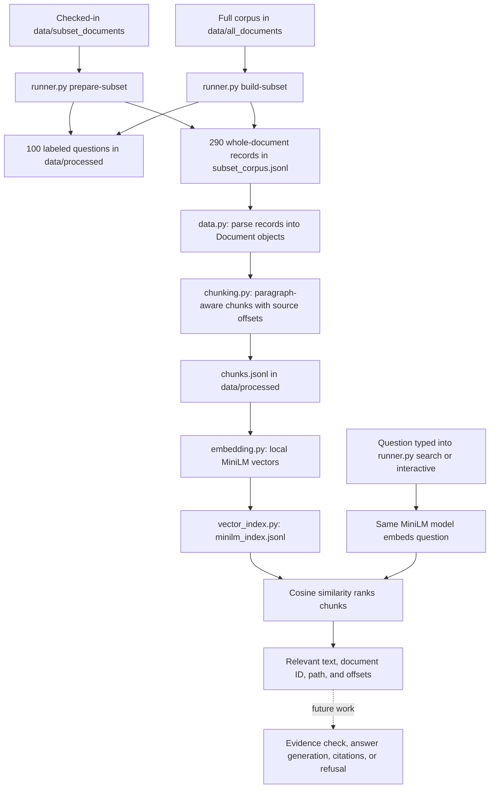

# Retrieval flow and data contracts

## The flow today



`runner.py` is the single command entry point. Its `demo` command still runs the
older synthetic keyword example. The `chunk`, `embed`, and `search` commands run
on the generated evaluation corpus. Search returns evidence, **not an answer**.
The cache, reranker, evidence checker, generator, and evaluation runner in
`PLAN.md` remain future work.

`runner.py interactive` opens a persistent terminal session. `interactive.py`
keeps one encoder, index, and corpus in memory across questions. It displays
complete retrieved passages and provides `/doc N` to inspect the original
document for a result. `/top N` changes the number of passages displayed, and
`/quit` ends the session.

## How one line becomes a Document

`data/processed/subset_corpus.jsonl` has one JSON object per line. A record has
`doc_id`, `text`, `source`, and `path` fields, plus evaluation fields such as
`is_gold` and `mined_for`. The parser in `data.py` validates the required fields
and duplicate IDs, then creates:

```python
Document(id=record["doc_id"], text=record["text"],
         source=record["source"], path=record["path"])
```

The evaluation fields do not enter the search index. This prevents answer labels
from telling retrieval which documents to rank. `chunking.py` then makes smaller
`Chunk` objects. Each chunk keeps its parent document ID, source path, and exact
`start_char`/`end_char` offsets in the original text. The index stores those
fields alongside each vector so a result can be traced to its source.
Before embedding, chunks that exceed MiniLM's input limit are split once more
using the model tokenizer. The index may therefore contain more pieces than
`chunks.jsonl`; every piece still has an exact source offset.

The checked-in `data/subset_documents/` directory contains 290 text files, a
100-question file, and a broader 500-question file. Run `prepare-subset` to build
the aligned 100-question/290-document corpus in `data/processed/`; use that
generated corpus for the `chunk` command. `build-subset` instead recomputes the
selection from the separate full corpus.

## Five small ideas

1. **Document = book.** One whole source file can be too long to search well.
2. **Chunk = sticky note.** Cut the book into small pieces, keeping the page
   address. The default uses paragraphs, up to 120 words with 20 words of overlap.
3. **Embedding = coordinates.** MiniLM turns each note and the question into a
   list of numbers that roughly represents meaning.
4. **Retrieval = nearby notes.** Cosine similarity ranks the notes whose numbers
   point in a similar direction to the question's numbers.
5. **Answering comes later.** A nearby note might still be wrong. A future
   evidence check and generator must decide what can actually be claimed.

## Chosen defaults and alternatives

| Chunking | Benefits | Costs |
| --- | --- | --- |
| **Paragraph-aware, size-capped (chosen)** | Usually keeps related sentences together; retains exact offsets | Variable chunk lengths; long paragraphs still split |
| Fixed 120-word windows | Simple, predictable baseline | Can cut a sentence or section in the middle |

Both strategies support overlap and can be selected with `--strategy`. They use
word counts for splitting. MiniLM performs a separate model-token length check
before encoding and reports an error if a chunk needs a smaller `--max-words`.

| Embedding model | Benefits | Costs |
| --- | --- | --- |
| **Local `all-MiniLM-L6-v2` (chosen)** | No API usage charge or document upload; 384-dimensional vectors | Initial model download and local compute; inputs above its token limit need smaller chunks |
| OpenAI `text-embedding-3-small` | Managed API; 1,536 dimensions by default; longer supported input | Requires API key, sends document text to the service, and charges per input token |

The MiniLM [model card](https://huggingface.co/sentence-transformers/all-MiniLM-L6-v2)
describes its dimensions and input truncation. The [OpenAI embedding guide](https://developers.openai.com/api/docs/guides/embeddings)
lists `text-embedding-3-small` dimensions and input limit; its [model page](https://developers.openai.com/api/docs/models/text-embedding-3-small)
lists current pricing. Retrieval quality on this corpus has not yet been measured,
so the model choice is a starting point, not a benchmark result.
